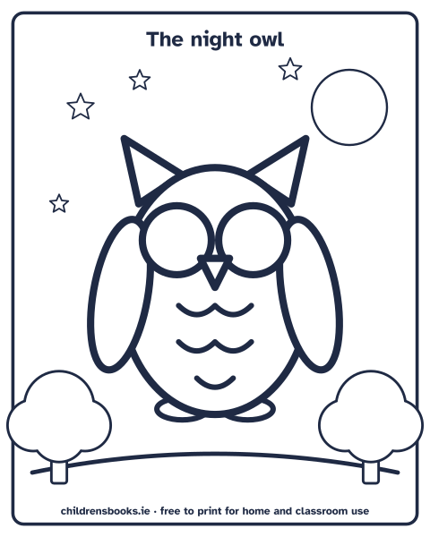
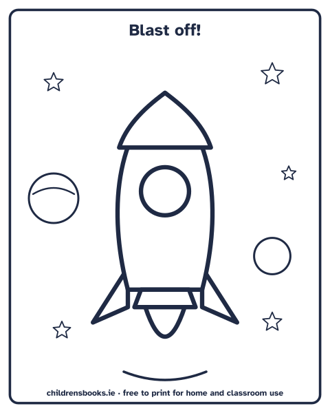
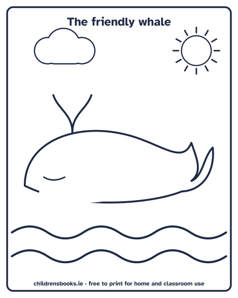
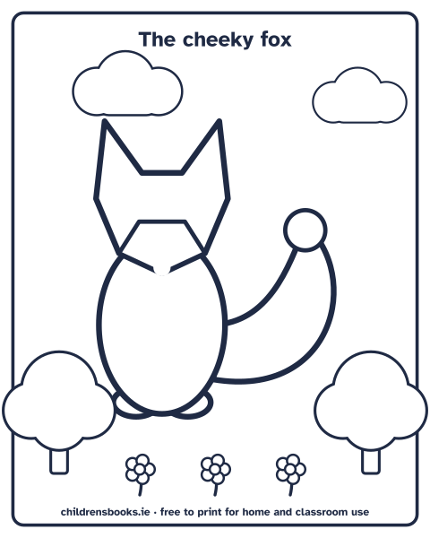
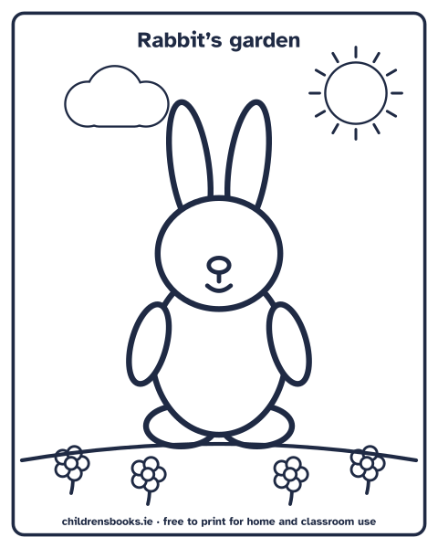
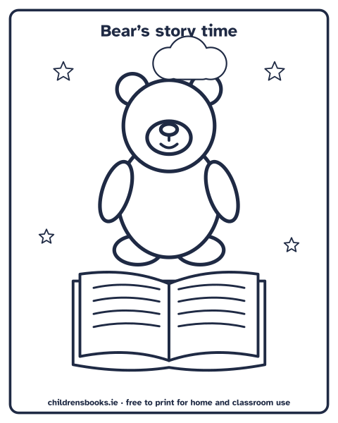
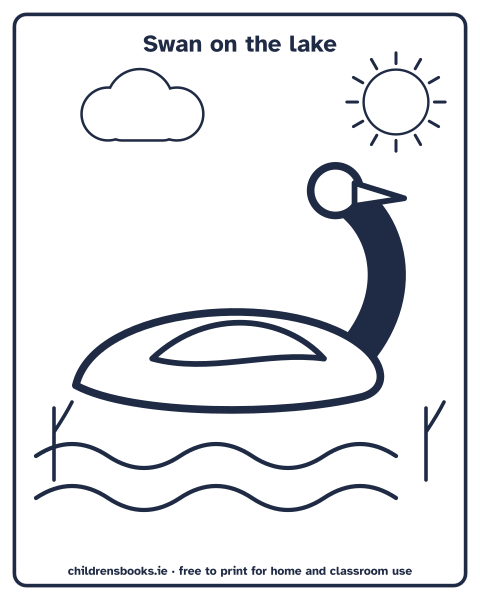
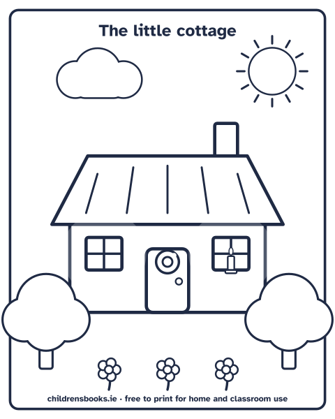

title: Free Printable Colouring Pages for Kids | Print at Home
h1: Free printable colouring pages for kids
short: Free colouring pages
description: Eight free printable colouring pages for children: owl, rocket, whale, fox, rabbit, bear, swan and cottage. Original A4 PDFs to print at home or school.
kind: guide
nav: /guides/
parent: guides
image: banner-colouring-pages
alt: Two sheets of paper, one outlined and one coloured in, beside a row of colourful crayons
lede: Eight original colouring pages, ready to print on A4 at home or in the classroom, with ideas to turn colouring time into story time.
related: book-activities-for-kids-at-home,printable-reading-log-and-chart-for-children,books-for-preschoolers,how-to-read-aloud-to-children
updated: 2026-11-14
---
Colouring is a calm, screen-free activity that builds hand control, concentration and confidence, and it pairs well with stories. These eight pages are our own original drawings. Each one is a free PDF sized for A4 paper that you can print as many times as you like for home, the classroom, the library or a birthday party.

## Choose a page to print

Tap a picture to download the PDF. Print at "actual size" or "fit to page" on plain paper. Thicker paper takes felt tips and paint better than thin paper does.

<ul class="printgrid">
<li><a href="/assets/print/colouring-owl.pdf" download><strong>The night owl</strong>Download PDF</a></li>
<li><a href="/assets/print/colouring-rocket.pdf" download><strong>Blast off!</strong>Download PDF</a></li>
<li><a href="/assets/print/colouring-whale.pdf" download><strong>The friendly whale</strong>Download PDF</a></li>
<li><a href="/assets/print/colouring-fox.pdf" download><strong>The cheeky fox</strong>Download PDF</a></li>
<li><a href="/assets/print/colouring-rabbit.pdf" download><strong>Rabbit’s garden</strong>Download PDF</a></li>
<li><a href="/assets/print/colouring-bear.pdf" download><strong>Bear’s story time</strong>Download PDF</a></li>
<li><a href="/assets/print/colouring-swan.pdf" download><strong>Swan on the lake</strong>Download PDF</a></li>
<li><a href="/assets/print/colouring-cottage.pdf" download><strong>The little cottage</strong>Download PDF</a></li>
</ul>

## Make colouring part of story time

- **Colour first, then read.** Colour the bear, then read a bear story such as [Winnie-the-Pooh](/winnie-the-pooh/). Colour the rabbit, then read [The Tale of Peter Rabbit](/the-tale-of-peter-rabbit/).
- **Invent the story.** Ask: what is the owl doing awake? Where is the rocket going? Write or tell the story as you colour.
- **Match the colours to a book.** Try the greens of a caterpillar, or the blues of a night sky, then compare with the pictures in [The Very Hungry Caterpillar](/the-very-hungry-caterpillar/) or [Guess How Much I Love You](/guess-how-much-i-love-you/).
- **Make a bookmark.** Colour a page, cut out a strip and use it to mark your place.
- **Display a gallery.** A fridge door or classroom wall of finished pages makes children proud.

## Tips for the best results

- **Pick the right pens.** Wax crayons suit little hands, felt tips give bold colour and coloured pencils suit older children who like detail.
- **Protect the table.** A sheet of newspaper helps if you use paint or marker pens.
- **Do not worry about staying in the lines.** For young children, the enjoyment matters far more than neatness.
- **Add to the page.** Invite children to draw their own extra characters, a background or a title.

## How old should children be?

Most children enjoy these pages from about 3 to 4 years, when they begin to hold crayons with some control, up to around 8. Older children can add pattern, shading and background detail.

## Terms of use

These pages are free for personal, home and classroom use. Please do not sell them or post them on other websites. If you share them, link to this page.

:::faq
### Are these colouring pages really free?
Yes. They are free to print for home, classroom or library use. Please link to this page rather than uploading the files elsewhere.

### What size are they?
They are made for A4 paper and will also print on US Letter if you choose "fit to page".

### Who drew them?
They are original artwork made for this site. They are not copies of any book illustration.

### What books go with colouring?
Picture books such as [The Gruffalo](/the-gruffalo/), [Where the Wild Things Are](/where-the-wild-things-are/) and [The Tiger Who Came to Tea](/the-tiger-who-came-to-tea/) work well, and so do the bedtime books in our [bedtime stories guide](/bedtime-stories-for-children/).
:::
