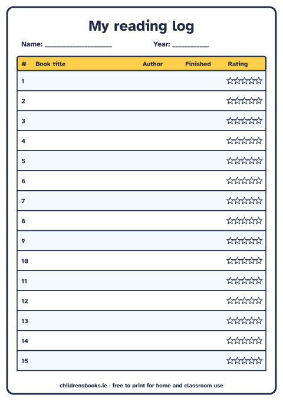
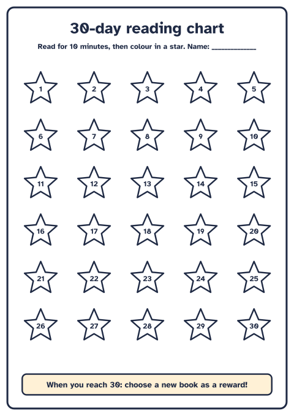

title: Printable Reading Log and Chart for Children | Free PDF
h1: Printable reading log and 30-day reading chart
short: Reading log and chart
description: Free printable reading log and 30-day reading chart for children. Track books read, add star ratings and build a daily reading habit. A4 PDFs.
kind: guide
nav: /guides/
parent: guides
image: banner-reading-log
alt: A chart of stars, some coloured in, beside an open book, a pencil and a small golden trophy
lede: Two free printables to help children track what they read and build a daily habit: a reading log for 15 books and a 30-day star chart.
related: how-to-help-a-reluctant-reader,how-to-read-aloud-to-children,free-printable-colouring-pages-for-kids,childrens-books-and-your-local-library
updated: 2026-11-14
---
Children love to see their progress. A simple chart on the fridge can turn "I have to read" into "I want to fill in my next star". These two A4 printables are free to download and use at home or in school.

<ul class="printgrid">
<li><a href="/assets/print/reading-log.pdf" download><strong>Reading log (15 books)</strong>Download PDF</a></li>
<li><a href="/assets/print/reading-chart.pdf" download><strong>30-day reading chart</strong>Download PDF</a></li>
</ul>

## How to use the reading log

1. Print one copy and write the child’s name and the year at the top.
2. After each book, add the title, the author and the date finished.
3. Colour in stars for a rating from one to five. Ask what they liked best.
4. When all 15 lines are full, celebrate and print a new sheet.

## How to use the 30-day chart

- Pick a daily reading time, such as before bed or after tea.
- After ten minutes of reading, the child colours in that day’s star. Reading aloud together counts.
- Do not worry about missing a day. Carry on the next day and aim for 30 stars in total, not 30 in a row.
- Agree on a reward before you start. A trip to the library or a new book works better than sweets.

## Ideas to make it work

- **Let them choose the books.** Children who pick their own are more likely to finish. Our guide to [reluctant readers](/how-to-help-a-reluctant-reader/) has more ideas.
- **Count everything.** Comics, graphic novels, audiobooks, picture books and non-fiction all count. The [Dog Man](/dog-man-10th-birthday-edition/) and [Bunny vs Monkey](/bunny-vs-monkey-day-of-the-heroes/) books are good for children who like comics.
- **Visit the library.** Add a library trip to the chart. See [children’s books and your local library](/childrens-books-and-your-local-library/).
- **Set a family goal.** A shared sheet for the whole family is fun, and parents’ books count too.
- **Keep the old sheets.** A folder of finished logs makes a lovely record of the year.

## Which book next?

Not sure what to put on the first line? Try our [Top 20 children’s books](/top-20-childrens-books/), the [best children’s books of all time](/best-childrens-books-of-all-time/) or [books by age](/books-by-age/).

:::faq
### How many minutes should a child read each day?
There is no single rule. Ten to twenty minutes of reading or being read to is a common goal, and it can include reading aloud together.

### What if my child cannot read yet?
Use the 30-day chart for reading aloud. Colour in a star each time you share a story.

### Can teachers use these in class?
Yes. They are free to print for classroom use. Please link to this page rather than posting the files elsewhere.

### Does it matter what children read?
No. Comics, magazines, picture books and non-fiction all build reading habits.
:::
